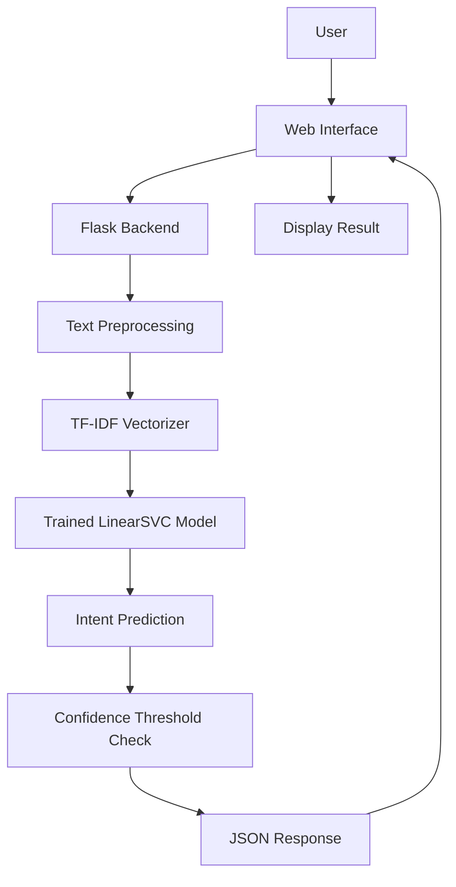
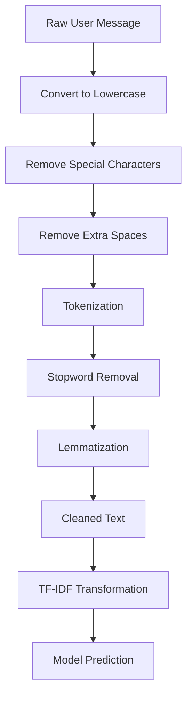
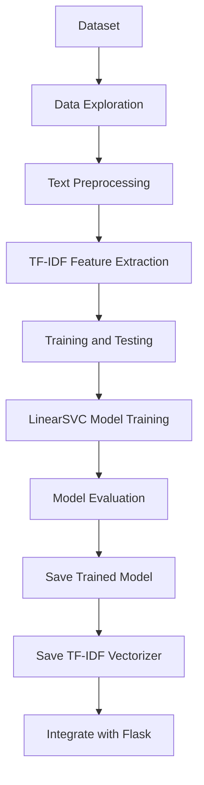

# Communication and Intent Detection

<p align="center">
  <b>An NLP and Machine Learning Based Web Application</b>
</p>

<p align="center">
  
  
  
  
</p>

## 1. Project Overview

Communication and Intent Detection is a Natural Language Processing (NLP) and Machine Learning-based project designed to identify the intent behind a user's text message.

The application analyzes user input, preprocesses the text, converts it into numerical features using TF-IDF Vectorization, and predicts the intent using a trained LinearSVC classification model.

A Flask-based web application provides an interactive interface through which users can enter messages and receive predicted intents.

## 2. Problem Statement

Understanding the intention behind a user's message is an important part of effective human-computer interaction.

Manually identifying the purpose of every message can be time-consuming. This project aims to automate the process by using NLP and Machine Learning techniques to classify text messages according to their intended meaning.

## 3. Objectives

- Develop an NLP-based intent detection system.
- Preprocess user messages to improve text representation.
- Convert text into numerical features using TF-IDF.
- Train a Machine Learning classification model.
- Integrate the trained model with a Flask web application.
- Provide intent predictions and confidence estimates.
- Handle messages for which the predicted intent has low confidence.

## 4. Technologies Used

| Technology | Purpose |
|---|---|
| Python | Main programming language |
| NLP | Text processing and analysis |
| NLTK | Stopword removal and lemmatization |
| TF-IDF | Text feature extraction |
| LinearSVC | Intent classification |
| scikit-learn | Machine Learning |
| NumPy | Numerical operations |
| Joblib | Saving and loading trained models |
| Flask | Backend web framework |
| HTML | Webpage structure |
| CSS | Interface styling |
| JavaScript | Frontend interaction |
| Google Colab | Model training |

## 5. System Architecture

The application follows a frontend-backend-machine-learning architecture.



### Architecture Components

1. **Frontend:** Accepts the user's message through the web interface.
2. **Flask Backend:** Receives the input and manages prediction requests.
3. **Text Preprocessing:** Cleans the message and performs NLP operations.
4. **TF-IDF Vectorizer:** Converts text into numerical feature vectors.
5. **LinearSVC Model:** Predicts the most likely intent.
6. **Confidence Check:** Checks the confidence estimate against the configured threshold.
7. **Response:** Sends the predicted intent or unknown result to the frontend.

## 6. Working Methodology

The application follows these steps:

1. User enters a message.
2. The Flask backend receives the message.
3. The input text is converted to lowercase.
4. Special characters and unnecessary spaces are removed.
5. Stopwords are filtered.
6. Lemmatization is applied to the remaining words.
7. TF-IDF transforms the cleaned text into numerical features.
8. The trained LinearSVC model predicts the intent.
9. A confidence estimate is calculated.
10. If the estimate is below 30%, the application returns an unknown intent.
11. Otherwise, the predicted intent and confidence estimate are returned.

### Text Processing Workflow



## 7. Machine Learning Workflow

The Machine Learning training process is performed using Google Colab.



The trained model and vectorizer are saved as:

- `intent_model.pkl`
- `tfidf_vectorizer.pkl`

These files are loaded by the Flask application for making predictions.

The Google Colab training notebook is also included in this repository for reference.

## 8. Features

- Text-based intent prediction.
- NLP-based text preprocessing.
- TF-IDF feature extraction.
- Machine Learning-based classification.
- Interactive web interface.
- Confidence estimation.
- Low-confidence / unknown intent handling.
- Integration of a trained model with Flask.

## 9. Project Structure

```text
Communication_Intent_Detection/
│
├── Communication_and_Intent_Detection.ipynb
│
├── app.py
├── intent_model.pkl
├── tfidf_vectorizer.pkl
├── requirements.txt
├── README.md
│
├── static/
│   ├── style.css
│   └── script.js
│
└── templates/
    └── index.html
```

## 10. Installation and Execution

### Step 1: Clone the Repository

```bash
git clone https://github.com/CharuRana2006/Communication-Intent-Detection.git
```

### Step 2: Open the Project Directory

```bash
cd Communication-Intent-Detection
```

### Step 3: Create a Virtual Environment (Recommended)

```bash
python -m venv .venv
```

Activate it on Windows:

```bash
.venv\Scripts\activate
```

### Step 4: Install Dependencies

```bash
pip install -r requirements.txt
```

### Step 5: Download NLTK Resources

Run the following command once in your Python environment:

```bash
python -c "import nltk; nltk.download('stopwords'); nltk.download('wordnet'); nltk.download('omw-1.4')"
```

### Step 6: Run the Application

```bash
python app.py
```

### Step 7: Open in Browser

Visit:

http://127.0.0.1:5000

## 11. Model Confidence and Unknown Intent Handling

The application uses a confidence threshold of 30%.

If the calculated confidence estimate is below this threshold, the system returns an unknown intent instead of displaying the predicted class as a confident result.

**Important:** The current LinearSVC confidence estimate is derived by applying a softmax-like transformation to decision scores. It is not a calibrated probability and should not be interpreted as a guaranteed measure of prediction correctness.

## 12. Model Evaluation and Graphs

The model should be evaluated using appropriate classification metrics.

The following visualizations can be included after obtaining the actual evaluation results from the training notebook:

### A. Confusion Matrix

Shows the relationship between actual and predicted intent classes.

### B. Performance Metrics

A bar chart comparing:

- Accuracy
- Precision
- Recall
- F1-score

### C. Classification Report

Provides class-wise precision, recall, F1-score and support.

*Note: Actual evaluation values and graphs should be generated from the trained model's test-set predictions. No unverified performance values are reported here.*

## 13. Screenshots

Add screenshots of the running application in the following section.

| Screenshot | Description |
|---|---|
| Home Page | Main application interface |
| User Input | Message entered by the user |
| Prediction Result | Successfully predicted intent |
| Unknown Intent | Low-confidence prediction response |

Suggested folder:

```text
screenshots/
├── home-page.png
├── prediction-result.png
└── unknown-intent.png
```

## 14. Future Improvements

- Expand the training dataset with more diverse messages.
- Improve intent classification and generalization.
- Explore alternative classification algorithms.
- Improve unknown-intent detection.
- Add more detailed model evaluation visualizations.
- Improve the web interface and user experience.
- Explore deployment options for online access.

## 15. Project Learning Outcomes

Through this project, the following concepts are demonstrated:

- Natural Language Processing.
- Text preprocessing.
- TF-IDF feature extraction.
- Supervised Machine Learning.
- Text classification using LinearSVC.
- Model serialization using Joblib.
- Flask backend development.
- Frontend and backend integration.
- Prediction confidence handling.

## 16. Conclusion

Communication and Intent Detection demonstrates how Natural Language Processing and Machine Learning can be integrated into a web application to identify the intent behind user messages.

The project combines text preprocessing, TF-IDF feature extraction, LinearSVC classification, and Flask-based application development to create an end-to-end intent detection system.

## 17. Repository

GitHub Repository:

https://github.com/CharuRana2006/Communication-Intent-Detection

---

<p align="center">
  <b>Communication and Intent Detection</b><br/>
  Built using Python, NLP, Machine Learning and Flask.
</p>